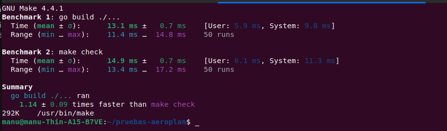
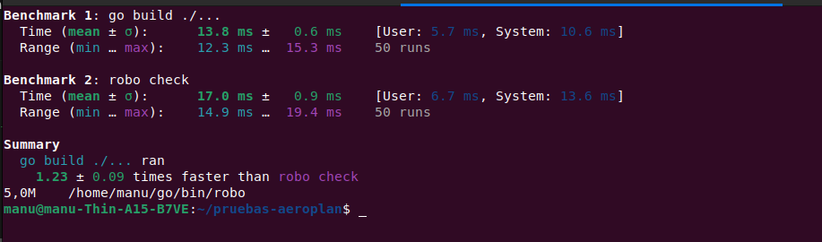
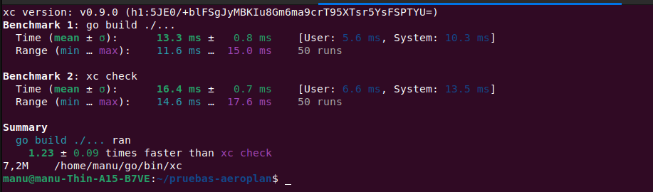
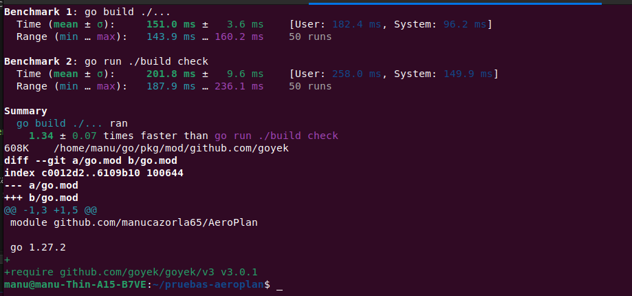

# Gestor de dependencias

Go incluye su propio gestor de dependencias, los módulos `go mod`, desde la versión 1.11, y desde la versión 1.16 es el modo que se usa por defecto. 

# Elección del gestor de tareas
## Alternativas consideradas

He analizado las siguientes herramientas:

- GNU Make: las tareas se definen en el `Makefile`
- Robo: las tareas se definen en un fichero YAML `robo.yml`
- xc: las tareas se definen en bloques de código dentro de un fichero Markdown
- goyek: las tareas se definen como código Go dentro del propio proyecto

## Criterios

He considerado únicamente criterios que se pueden medir sobre el propio proyecto:

- Tiempo necesario para ejecutar la tarea `check`.
- Sobrecarga que añade la herramienta respecto a ejecutar `go build ./...` directamente.
- Tamaño de la herramienta instalada.
- Software adicional que hay que instalar para poder usarla.
- Dependencias que añade al proyecto.
- Número de líneas necesarias para definir la tarea `check`.
- Mantenimiento: fecha del último commit o versión publicada.

## Resultados

### GNU Make

- Tiempo de `make check`: 14,9 ms ± 0,7 ms, frente a 13,1 ms ± 0,7 ms de `go build ./...` (1,14 ± 0,09 veces más lento, 1,8 ms de sobrecarga).
- Tamaño instalado: 292 KB.
- Software adicional: ninguno, ya estaba instalado en el sistema.
- Dependencias que añade al proyecto: ninguna.
- Líneas para definir `check`: 2.
- Mantenimiento: la última versión es la 4.4.1, publicada el 26 de febrero de 2023 ([GNU Make](https://www.gnu.org/software/make/)).

### Robo

- Tiempo de `robo check`: 17,0 ms ± 0,9 ms, frente a 13,8 ms ± 0,6 ms de `go build ./...` (1,23 ± 0,09 veces más lento, 3,2 ms de sobrecarga).
- Tamaño instalado: 5,0 MB.
- Software adicional: el binario de Robo, que hay que instalar aparte.
- Dependencias que añade al proyecto: ninguna.
- Líneas para definir `check`: 3.
- Mantenimiento: el último commit y la última versión (v0.8.0) son del 19 de octubre de 2022, y no ha tenido cambios desde entonces ([repositorio](https://github.com/tj/robo)).

### xc

- Tiempo de `xc check`: 16,4 ms ± 0,7 ms, frente a 13,3 ms ± 0,8 ms de `go build ./...` (1,23 ± 0,09 veces más lento, 3,1 ms de sobrecarga).
- Tamaño instalado: 7,2 MB.
- Software adicional: el binario de xc, que hay que instalar aparte.
- Dependencias que añade al proyecto: ninguna, aunque las tareas tienen que escribirse dentro del `README.md`.
- Líneas para definir `check`: 6.
- Mantenimiento: la última versión es la v0.9.0, del 5 de enero de 2026, y el último commit es del 18 de septiembre de 2026 ([repositorio](https://github.com/joerdav/xc)).

### goyek

- Tiempo de `go run ./build check`: 201,8 ms ± 9,6 ms, frente a 151,0 ms ± 3,6 ms de `go build ./...` (1,34 ± 0,07 veces más lento, 50,8 ms de sobrecarga).
- En esta medición `go build ./...` tarda más que en las demás porque el código de las tareas (`build/`) forma parte del proyecto y también se compila.
- Tamaño del módulo descargado: 608 KB.
- Software adicional: ninguno aparte de Go.
- Dependencias que añade al proyecto: `github.com/goyek/goyek/v3 v3.0.1` en el `go.mod`.
- Líneas para definir `check`: 21.
- Mantenimiento: la última versión es la v3.0.1, del 9 de diciembre de 2025, y el último commit es del 9 de septiembre de 2026 ([repositorio](https://github.com/goyek/goyek)).

## Elección final

Después de realizar todas las mediciones, he elegido GNU Make como gestor de tareas para AeroPlan:

- Es la herramienta que menos sobrecarga añade a `go build ./...`: 1,8 ms, frente a unos 3 ms de Robo y xc  y unos 50 ms de goyek. La diferencia con Robo y xc es pequeña, pero en todas las mediciones Make ha sido la más rápida.
- Es la que menos ocupa 292 KB, frente a los 5,0 MB de Robo y los 7,2 MB de xc.
- No hay que instalar software adicional ni añade dependencias al proyecto. Robo y xc necesitan instalar cosas adicionales, y goyek añade una dependencia al `go.mod` y código que se compila junto con el resto del proyecto.
- La tarea `check` se define en solo 2 líneas.

En cuanto al mantenimiento, xc y goyek tienen versiones más recientes que Make, cuya última versión es de febrero de 2023, así que en este criterio Make no es la mejor opción. En cambio, Robo no tiene cambios desde octubre de 2022, por lo que usarlo aumentaría la deuda técnica del proyecto. Teniendo en cuenta el resto de criterios, Make es la opción más adecuada bajo mi consideración.